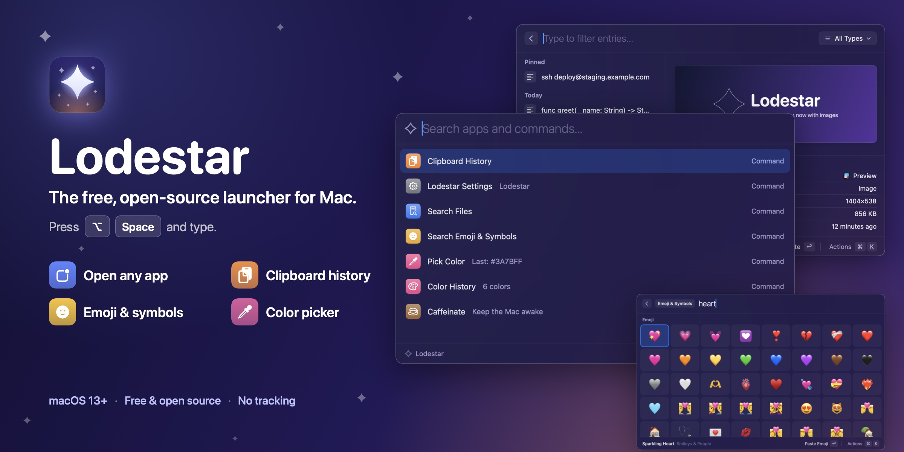

<p align="center">
  
</p>

<p align="center">
  <strong>Free, open-source launcher for Mac — a fast Spotlight, Alfred and Raycast alternative.</strong><br>
  Open any app, search your clipboard history, paste emoji and pick colors without leaving the keyboard.<br>
  <a href="https://leoanimesh.github.io/lodestar/"><strong>leoanimesh.github.io/lodestar</strong></a>
</p>

<p align="center">
  <a href="https://github.com/leoAnimesh/lodestar/releases/latest"></a>
  <a href="https://github.com/leoAnimesh/lodestar/actions/workflows/ci.yml"></a>
  
  <a href="LICENSE"></a>
</p>

Press **⌥ Space** anywhere, type a few letters, press Return. That's Lodestar. It lives in your menu bar,
opens instantly, and learns which apps you use most. Everything runs on your Mac: no account, no
analytics, no tracking.

> **Independent project.** Lodestar is not affiliated with, endorsed by, or derived from the source code of Raycast or Raycast Technologies Ltd. It is a clean-room implementation of a common app category (Spotlight, Alfred, LaunchBar and others are in the same space). No proprietary code, decompiled code, assets, icons, or text from any other product are included. "Raycast" is a trademark of its owner.

## What it does

- **Open any app in a keystroke.** Type `sl` for Slack or `cal` for Calendar. A few letters from anywhere in the name are enough, and the apps you use most rise to the top.
- **Never lose something you copied.** Clipboard history keeps text, links, images, colors and files. Pin the ones you reuse. Your history stays on your Mac.
- **Emoji and symbols, by name.** Type `rocket` or `thumbs up`, press Return, and it's pasted. Includes ⌘ ⌥ ⇧ arrows, math and currency symbols too.
- **Quick math.** Type `2^10 / 4` and see `256` right away. Return copies the answer.
- **Pick any color on screen.** Grab a pixel, get its HEX or RGB, and find it again later in Color History.
- **Keep your Mac awake.** Caffeinate stops your Mac from sleeping during a download or a talk.
- **Find files.** Search your home folder and open a file, show it in Finder, or open it with another app.
- **Control your Mac.** Lock, sleep, restart, empty the Trash, toggle Dark Mode and more.
- **Do more with ⌘K.** Every result has extra actions, each with its own shortcut.
- **Make it yours.** Change the shortcut, give commands short aliases, or bind any command to its own hotkey.
- **Add your own commands.** Drop in a shell script, or write an extension in any language.

## Install

### Download

1. Get **Lodestar-X.Y.Z.dmg** from the [latest release](https://github.com/leoAnimesh/lodestar/releases/latest).
2. Open it and drag **Lodestar** into **Applications**.
3. Open Lodestar. It needs macOS 13 or later and runs on Apple silicon and Intel Macs.

Releases since v0.1.1 are signed with a Developer ID and notarized by Apple, so macOS opens them
like any other app. Each release also has a `SHA256SUMS.txt` if you want to check your download:
`shasum -a 256 -c SHA256SUMS.txt`.

### Homebrew

```sh
brew tap leoanimesh/lodestar https://github.com/leoAnimesh/lodestar
brew install --cask lodestar
```

### Build it yourself

You need macOS 13+ and Xcode (or the Command Line Tools).

```sh
git clone https://github.com/leoAnimesh/lodestar.git
cd lodestar
./scripts/bundle.sh
open build/Lodestar.app
```

A local build is ad-hoc signed, not notarized. It opens fine on the Mac that built it, but its signature
changes with every rebuild, so you may need to turn Accessibility off and on again after rebuilding.
If you copy a local build to another Mac, macOS will ask you to approve it (right-click › **Open**, or
**Open Anyway** in System Settings › Privacy & Security). More in [docs/DEVELOPMENT.md](docs/DEVELOPMENT.md).

## Getting started

The first launch opens a short welcome window: pick your shortcut, grant permissions, and try a live
tour. After that, press **⌥ Space** whenever you want Lodestar, or click the star in the menu bar.

**Permissions.** Pasting for you (clipboard history, emoji) and Lock Screen need **Accessibility**
access: System Settings › Privacy & Security › Accessibility. Commands like Empty Trash ask for
**Automation** the first time. The welcome window and Settings › Advanced show what's granted.

**Shortcut taken?** If another app already uses ⌥ Space, Settings shows a message. Pick a different
shortcut there.

### Handy keys

| Key | What it does |
| --- | --- |
| Return | Open or run the selected item |
| ⌘ Return | The second action (for example, copy instead of paste) |
| ⌘ K | All actions for the selected item |
| ↑ ↓ | Move the selection |
| Esc | Go back, clear the search, then close |
| ⌘ , | Settings |

## Updates

Lodestar checks GitHub once a day for a new version and asks before installing it. You can also choose
**Check for Updates…** in the menu bar or in Settings › General, and turn automatic checks off there.

When you click **Install & Relaunch**, Lodestar downloads the new version from GitHub, checks it
against the release's published checksum, replaces itself, and reopens. If anything doesn't match,
nothing is changed. The check sends only the app's version in its `User-Agent`; nothing about you or
your files.

Notarized releases are all signed with the same Developer ID, so permissions such as Accessibility carry
over between updates. Coming from v0.1.0 (which was ad-hoc signed), macOS may ask once to **turn
Accessibility back on**: open System Settings › Privacy & Security › Accessibility, remove Lodestar with
**−**, and add it again.

## Privacy

- No account, analytics or tracking.
- Clipboard history is stored only on your Mac, readable only by you, and skips passwords that
  password managers mark as private.
- Copying a link never makes a network request.
- The only network request Lodestar makes on its own is the daily update check to api.github.com
  (you can turn it off). Web search and opening links happen only when you ask.

## Customize and extend

- **Settings** (⌘ , in the launcher): shortcut, appearance, launcher position, clipboard history
  size, and every command's alias, hotkey and on/off switch.
- **Config file**: `~/.config/lodestar/config.json` — see [docs/CONFIGURATION.md](docs/CONFIGURATION.md).
- **Script commands**: any script in `~/.config/lodestar/scripts/` becomes a command — see
  [docs/SCRIPT-COMMANDS.md](docs/SCRIPT-COMMANDS.md).
- **Extensions**: list-style commands in any language, with a tiny Node helper — see
  [docs/EXTENSIONS.md](docs/EXTENSIONS.md).

Scripts and extensions run with your user permissions, so only install ones you trust.

## Roadmap

- Snippets / text expansion
- Quicklinks with `{query}` placeholders
- Richer extension UI (forms, grids, preferences)
- Unit and currency conversion in the calculator

## Contributing

Issues and pull requests are welcome. Run `swift test` before opening a pull request.
[docs/DEVELOPMENT.md](docs/DEVELOPMENT.md) covers building, the project layout and screenshots;
[docs/RELEASING.md](docs/RELEASING.md) covers how releases are made.

## License

MIT — see [LICENSE](LICENSE). The bundled emoji data comes from Unicode and CLDR under the Unicode
License v3 — see [THIRD_PARTY_NOTICES.md](THIRD_PARTY_NOTICES.md).
