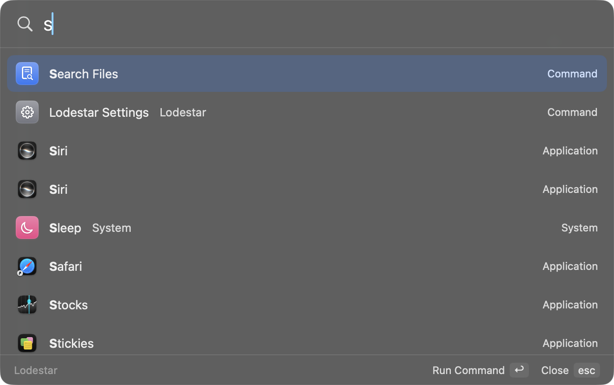
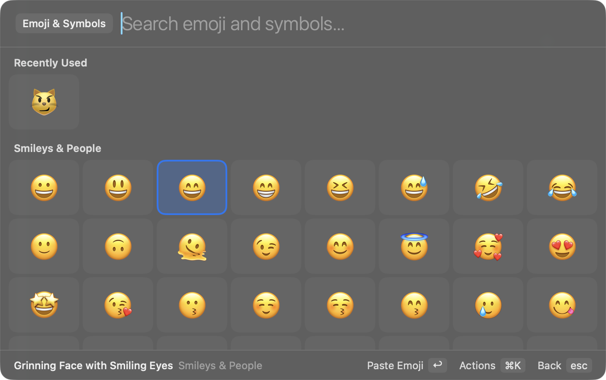
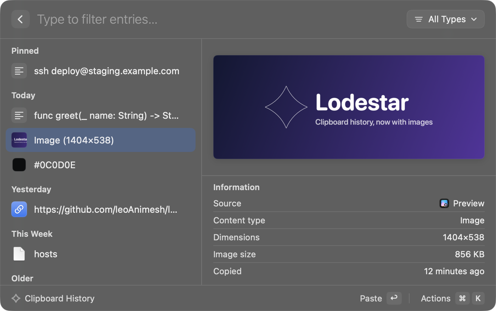
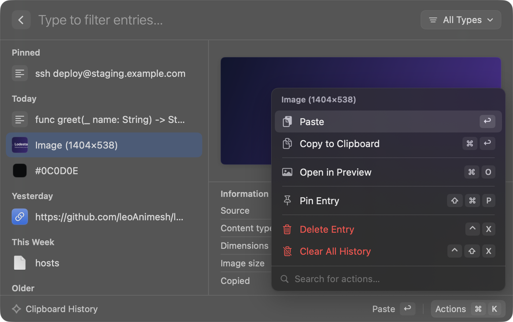
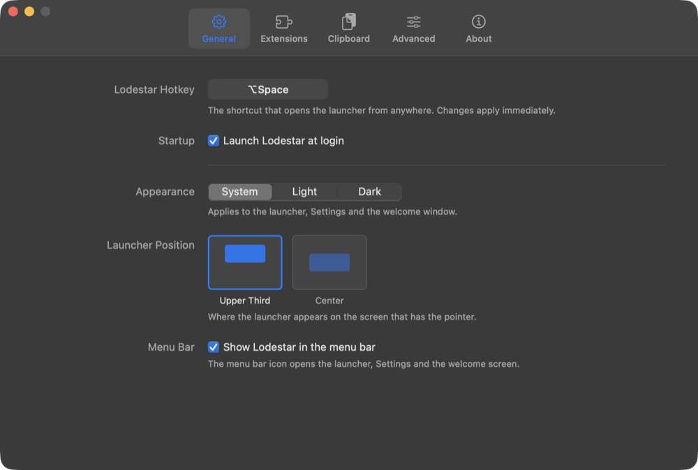
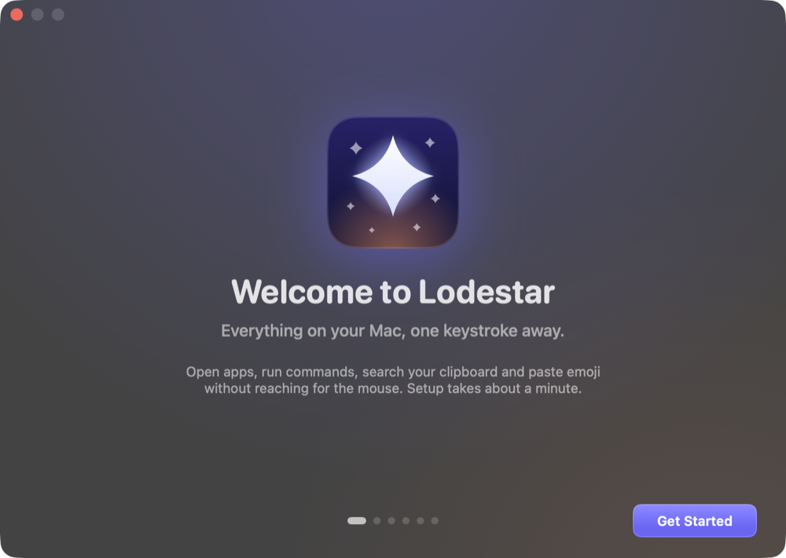

<p align="center">
  
</p>

<h1 align="center">Lodestar</h1>

<p align="center">
  <strong>Free, open-source, keyboard-first launcher for macOS &mdash; a native Raycast and Spotlight alternative.</strong><br>
  Launch apps, do quick math, search clipboard history, paste emoji, pick colors and run your own scripts and extensions.
</p>

<p align="center">
  
  
  <a href="LICENSE"></a>
</p>

Lodestar is a native macOS launcher built with Swift and SwiftUI. Press **⌥Space**, type a few letters, hit
Return. Fuzzy app search learns what you use (frecency), and the rest is built in: a calculator, clipboard
history, an emoji and symbol picker, a color picker, Spotlight file search, system commands, Raycast-compatible
script commands and a simple JSON-over-stdio extension protocol. No accounts, no analytics, no tracking.

> **Independent project.** Lodestar is not affiliated with, endorsed by, or derived from the source code of Raycast or Raycast Technologies Ltd. It is a clean-room implementation of a common app category (Spotlight, Alfred, LaunchBar and others are in the same space). No proprietary code, decompiled code, assets, icons, or text from any other product are included. "Raycast" is a trademark of its owner.

## Screenshots

| | |
|---|---|
|  |  |
| **Launcher** &mdash; one search box for apps, commands and system actions. | **Emoji &amp; Symbols** &mdash; every Unicode 17.0 emoji plus symbols, searchable by name. |
|  |  |
| **Clipboard History** &mdash; text, links, colors, images and files, with a preview and details. | **Actions** &mdash; ⌘K opens a compact popover with every action and its shortcut. |
|  |  |
| **Settings** &mdash; record your own hotkey; per-command aliases, hotkeys and toggles. | **Welcome** &mdash; a one-minute first-run setup with a live tour. |

<sub>Screenshots are generated by `swift run Lodestar --snapshot <dir>` from a clean run; no personal data is shown.</sub>

## Features

Everything runs locally. No accounts, no analytics, no network calls of its own.

| Feature | Notes |
| --- | --- |
| Global hotkey | ⌥Space by default (Carbon `RegisterEventHotKey`; needs no permission). Change it in Settings with the shortcut recorder; it applies immediately, no restart. |
| Welcome window | First-run onboarding: shortcut, permissions (live status), launch at login, an interactive feature tour. Reopen it any time with **Show Welcome…** in the menu bar. |
| Settings window | Tabs for General, Extensions, Clipboard, Advanced and About. Open it from the menu-bar item, with ⌘, in the launcher, or with the **Lodestar Settings** command. |
| Per-command settings | Turn any command off, give it an alias, or bind it to its own global hotkey (Settings › Extensions). |
| Floating launcher panel | Non-activating `NSPanel`, so your current app stays frontmost and paste/window actions target it. |
| Action popover | The footer shows the primary action (↩) and an **Actions ⌘K** button. ⌘K (or a click) opens a compact popover above it with every action of the selected item, its shortcut and a filter field; the list stays visible behind it. Arrows move, Return runs, typing filters, Esc or ⌘K closes. Works on every screen. Files and folders (file search results, clipboard file entries) also get **Open With…** (⇧⌘O): a nested list of the apps that can open the item, the default app first, searchable from the same field; Esc or ← goes back. |
| Command icons | Built-in commands show a white SF Symbol on a colored, gently graded tile. App icons are shown as-is. Colors are set in one place, `UI/IconTint.swift`; extensions get a stable hashed color. |
| App search | Scans `/Applications`, `/System/Applications`, `~/Applications`, etc. |
| Fuzzy ranking | DP-based subsequence matcher with word-start/acronym/consecutive bonuses, blended with **frecency** (use count with a 7-day half-life). Matched letters are bolded. |
| Calculator | Inline results for expressions like `2^10 / 3`, `sqrt(2)*pi`, `5!`, `3 x 4`. Return copies, ⌘Return pastes. |
| Emoji & symbols | **Search Emoji & Symbols** opens a grid of every Unicode 17.0 emoji (1,900+, newer ones hidden on macOS versions that can't draw them) plus 880 symbols: keyboard (⌘⌥⇧⌃⏎⌫⎋⇥), arrows, math, currency, punctuation & typography, Greek letters, stars & shapes, box drawing. Search by name, CLDR keyword, flag ISO code (`jp`), the character itself or code point (`U+1F680`). Favorites and Recently Used sit on top; a default skin tone applies to people and hand emoji. Strong matches (`rocket`, `thumbs up`) also appear in the main search, below apps and commands. |
| Pick Color | **Pick Color** samples any pixel on screen with the system eyedropper and copies it; **Color History** keeps the colors you picked. |
| Caffeinate | **Caffeinate** / **Decaffeinate** keep your Mac awake, or let it sleep again. |
| Clipboard history | Records text (keeping its RTF/HTML formatting for Paste), links, colors (`#hex`, `rgb()`, `hsl()`), images and file references, with the app it was copied from and when. A split view lists entries under Pinned / Today / Yesterday / This Week / Older with thumbnails and swatches, and previews the selection with an Information table (source app, type, characters/words/lines, dimensions and size, HEX/RGB, path, copied time). Filter by type with the dropdown or ⌘P. Actions: Paste, Copy, Paste as Plain Text, Open Link / Open File / Show in Finder / Open With… / Open in Preview, Copy Color as HEX/RGB/HSL, Pin (⇧⌘P), Delete (⌃X) and Clear All (⌃⇧X, confirms). Up to 300 entries by default; pinned entries are never pruned. Stored owner-only: the list in `~/Library/Application Support/Lodestar/clipboard.json` (0600), images and formatting in `clipboard/` next to it (folder 0700, files 0600), deleted with their entry. Skips items that password managers mark concealed or transient. Links show a link icon; no favicons are fetched, so copying a URL never causes a network request. |
| System commands | Lock, Sleep, Sleep Displays, Restart, Shut Down, Log Out, Empty Trash, Toggle Dark Mode, Hide All Apps, Quit All Apps, Eject All Disks. Destructive ones ask for confirmation. |
| File search | Spotlight-backed (`NSMetadataQuery`), scoped to your home folder. Actions: Open (⌘O), Reveal in Finder (⇧⌘F), Open With… (⇧⌘O), Copy Path. |
| Script commands | Any executable script with `@lodestar.*` metadata comments. |
| Extensions | Any language; JSON over stdio. Includes a tiny Node SDK. |
| Fallbacks | Open the query as a URL, or search the web (DuckDuckGo). |

### Keyboard

| Key | Action |
| --- | --- |
| ↑ / ↓, ⌃P / ⌃N | Move the selection |
| ← / → | Move the selection in a grid (emoji & symbols) |
| ⌫ on an empty query | Go back to the previous screen |
| Return | Primary action |
| ⌘Return | Secondary action |
| ⌘K | Open or close the action popover for the selected item |
| ⌘P | Open the type filter (Clipboard History) |
| ⇧⌘P, ⌃X, ⌃⇧X | Pin, delete, clear all (Clipboard History) |
| ⌘, | Open Settings |
| ⌘1 … ⌘5 | Switch Settings tabs (in the Settings window) |
| Esc | Close a popover or the detail view, go back, clear the query, then hide |

## Install (build from source)

Lodestar has no releases yet, so you build it from source. It requires macOS 13+ and a Swift 5.9+ toolchain (Xcode or the Command Line Tools).

```bash
swift build                 # debug build
swift test                  # unit tests (+ a Node protocol test if `node` is installed)
swift run Lodestar --show   # run and show the panel immediately
swift run Lodestar --onboarding  # run and open the welcome window
swift run Lodestar --clipboard-selftest  # check clipboard capture on a private pasteboard

./scripts/bundle.sh         # release build wrapped as build/Lodestar.app (ad-hoc signed)
open build/Lodestar.app
```

Lodestar runs as a menu-bar accessory: it has no Dock icon and shows a magnifying-glass status item (you can hide it in Settings › General). The bundle script also renders the app icon, which is drawn in code (`UI/Brand.swift`), into `AppIcon.icns`.

## First run

The first launch opens the **welcome window** instead of the launcher. It has six steps with progress dots and Back/Continue:

1. **Welcome.**
2. **Shortcut.** Record a new launcher shortcut. Picking ⌘Space (or another combo macOS already uses) shows a warning, with a button to System Settings › Keyboard.
3. **Permissions.** Accessibility, Automation and (optional) Full Disk Access, each with a live status that updates within about a second of a change in System Settings, and a button that opens the system prompt or the right pane. Nothing is changed for you.
4. **Launch at login** and the menu-bar icon.
5. **Tour.** A working mini launcher: try fuzzy search, the ⌘K action panel, clipboard history and the calculator.
6. **Done.** Shows your shortcut and opens the launcher.

Finishing or closing the window records `onboardingCompletedVersion` in UserDefaults, so it doesn't open again. To see it again, choose **Show Welcome…** from the menu bar, run the **Show Welcome Screen** command, use **Settings › Advanced › Welcome screen** (**Show Now**, or **Reset** to show it at next launch), or launch with `--onboarding`.

*Upgrading:* earlier builds set `didShowFirstLaunch` when they showed the launcher on first run. That flag is migrated to "onboarding completed" and removed, so existing users aren't interrupted.

**Permissions.** Auto-paste (⌘V synthesis, used by clipboard history and emoji) and Lock Screen need **Accessibility** access. Grant it in System Settings › Privacy & Security › Accessibility, or use the status-bar menu item. Run the bundled `.app` rather than the bare binary, because otherwise macOS attributes the permission to your terminal. System commands that use Apple Events will prompt for **Automation** the first time.

**Hotkey conflicts.** If another app (for example another launcher) already owns ⌥Space, registration fails. At launch a message is logged. In Settings the recorder shows the error inline and keeps your previous shortcut. Pick a different one in **Settings…** from the menu-bar item.

## Configuration

`~/.config/lodestar/config.json` (every key is optional):

```json
{
  "hotkey": "cmd+shift+space",
  "appDirectories": ["~/Dev/Apps"],
  "clipboardHistoryLimit": 300,
  "clipboardHistoryEnabled": true,
  "appearance": "dark",
  "launcherPosition": "center",
  "showMenuBarIcon": true,
  "emojiSkinTone": "medium",
  "commands": {
    "cmd:files": { "enabled": false },
    "cmd:clipboard": { "alias": "cb" },
    "sys:lock": { "hotkey": "ctrl+option+l" }
  }
}
```

- `appearance`: `system` (default), `light` or `dark`.
- `launcherPosition`: `upperThird` (default) or `center`.
- `emojiSkinTone`: default skin tone for emoji: `light`, `mediumLight`, `medium`, `mediumDark` or `dark` (missing = default yellow).
- `commands`: per-command settings keyed by command ID (shown in Settings › Extensions). Only changed values are stored.

The Settings window reads and writes this same file. It rewrites only the keys it manages and leaves any other keys alone. If the file isn't valid JSON, Settings shows an error instead of overwriting it.

- Changes made in Settings take effect immediately. Defaults are stored by omitting the key.
- Hand edits to the file are read at launch, so restart Lodestar after editing it.
- Scripts and extensions can be reloaded live with the **Reload Scripts and Extensions** command.

## Settings

Open **Settings…** from the menu-bar item, press **⌘,** while the launcher is open, or run **Lodestar Settings**. The window has a tab bar (⌘1–⌘5):

- **General.** The launcher shortcut, launch at login, appearance (System/Light/Dark), launcher position (upper third or center), and the menu-bar icon.
  - *Shortcut recorder.* Click the field and press the new combo. It must include ⌘, ⌥ or ⌃. **Esc** cancels and **Delete** restores ⌥Space. While recording, all global shortcuts are paused. If the combo can't be registered, an inline error appears and the previous shortcut stays active. Known system shortcuts such as ⌘Space (Spotlight) show a warning, because macOS keeps them even though registration "succeeds".
  - *Launch at login* uses `SMAppService.mainApp` and **only works in the bundled `build/Lodestar.app`**. With `swift run` the toggle is disabled. If macOS needs approval, a button opens System Settings › General › Login Items. Move the app somewhere stable (for example `/Applications`) first.
  - *Menu-bar icon.* If you hide it, use ⌘, in the launcher or the **Lodestar Settings** command. Opening Lodestar.app again shows the launcher.
- **Extensions.** Every command (built-ins, system commands, script commands and extension commands) in a searchable table grouped by source, with a type filter. Each row has:
  - an **enable** checkbox (disabled commands disappear from search and lose their hotkey; section headers toggle a whole group),
  - an **alias** (typing it exactly in the launcher puts that command first),
  - a **hotkey** that runs the command from anywhere.

  A detail pane shows the selected command's description, ID and file location. A menu reveals the scripts and extensions folders and reloads them. Applications aren't listed and are always searchable.
- **Clipboard.** Turn history on or off, set how many entries to keep, and clear it. All of these apply immediately.
- **Advanced.** Live permission statuses (Accessibility, Automation, Full Disk Access) with buttons that open the right System Settings pane, locations of the config file and folders, **Welcome screen** (show now, or reset so it opens at the next launch), and **Reset** for all command settings.
- **About.** Version, license and credits.

Command hotkeys that do something directly, such as system commands, run without opening the launcher. Commands with UI, such as Clipboard History or extensions, open it.

## Emoji & symbols

Run **Search Emoji & Symbols** (give it an alias or hotkey in Settings › Extensions). Typing filters the grid by name or keyword. Arrow keys move in two dimensions, and the footer shows the selected item's name and category.

- **Return** pastes into the frontmost app. Without Accessibility access it copies instead and says so. **⌘Return** copies.
- **⌘K** offers Copy Name, Copy Unicode Code Point, Add to / Remove from Favorites, reordering favorites, Clear Recently Used and Change Default Skin Tone….
- **Esc**, or **⌫** on an empty query, goes back to the main search.
- Favorites and recents are stored in `~/Library/Application Support/Lodestar/emoji.json`. The skin tone is `emojiSkinTone` in config.json, and it can also be set in Settings › Extensions › Search Emoji & Symbols.

**Data and license.** The data is `Sources/LodestarCore/Resources/emoji.json` (about 230 KB, bundled as a SwiftPM resource). `scripts/generate-emoji-data.py` generates it from Unicode's `emoji-test.txt` and `UnicodeData.txt` (17.0) and the CLDR 48 English annotations (names and keywords). The symbol selection and the keyboard symbol names are Lodestar's own. The Unicode data is © Unicode, Inc. and used under the [Unicode License v3](https://www.unicode.org/license.txt); the full notice is in [THIRD_PARTY_NOTICES.md](THIRD_PARTY_NOTICES.md), which `bundle.sh` also copies into the app. No emoji artwork is bundled, since glyphs come from the system font. To regenerate:

```bash
scripts/generate-emoji-data.py            # downloads the Unicode/CLDR files to a temp dir
```

## Script commands

Drop executable scripts into `~/.config/lodestar/scripts/`. Metadata lives in comments (`#`, `//` or `--`):

```bash
#!/bin/bash
# @lodestar.schemaVersion 1
# @lodestar.title Show Local IP Address
# @lodestar.mode compact          # silent | compact | fullOutput
# @lodestar.icon 🌐               # emoji, sf:<symbol-name>, or /absolute/path.png
# @lodestar.description Optional subtitle
# @lodestar.keywords network,ip
# @lodestar.argument1 { "type": "text", "placeholder": "Optional single argument" }
ipconfig getifaddr en0
```

- `silent`: runs the script and hides the launcher.
- `compact`: shows the last line of output in the footer.
- `fullOutput`: shows all output in a detail view.
- A non-zero exit always shows the output.

For compatibility with the community script-command format, the `@raycast.` metadata prefix is also accepted. See `Examples/scripts/` and the **Create Script Command** command.

## Extensions

An extension is a folder in `~/.config/lodestar/extensions/<name>/` that contains a `manifest.json`:

```json
{
  "name": "emoji-search",
  "title": "Emoji",
  "icon": "😀",
  "run": ["node", "index.js"],
  "commands": [
    { "name": "search", "title": "Search Emoji", "mode": "list", "keywords": ["emoji"] }
  ]
}
```

`run` is the argv to start. Interpreters such as `node` and `python3` are resolved through `PATH`, with Homebrew paths added. `./relative` paths are resolved against the extension folder. Each time a command is invoked, Lodestar spawns the process and exchanges **one JSON object per line** on stdin/stdout. stderr goes to the system log.

**Host → extension**

```json
{"type":"run","command":"search","query":"","protocol":1}
{"type":"query","text":"rock"}
{"type":"callback","id":"refresh"}
```

**Extension → host**

```json
{"type":"items","items":[{"id":"1","title":"rocket","subtitle":"…","icon":"🚀","accessory":"…",
  "actions":[{"type":"paste","text":"🚀"},{"type":"copy","text":"🚀"},
             {"type":"open","url":"https://…"},{"type":"callback","id":"refresh"}]}]}
{"type":"detail","markdown":"long text"}
{"type":"toast","message":"Done"}
{"type":"close"}
{"type":"error","message":"…"}
```

Actions are **declarative**, so the host performs privileged work (pasting, opening) on the extension's behalf, and extensions never need macOS permissions. The first action runs on Return and the rest are available via ⌘K. `callback` actions round-trip to your process so you can update the list.

- `list` commands stay alive while the user is in them and receive `query` messages as the user types. The process gets SIGTERM when the user leaves.
- `no-view` commands run detached and can send a `toast`.

For Node, `sdk/js/lodestar.js` (zero dependencies) handles the framing:

```js
const lodestar = require("./lodestar");
lodestar.command("search", {
  onQuery(text, ui) {
    ui.items([{ title: `You typed ${text}`, actions: [lodestar.copy(text)] }]);
  },
});
lodestar.start();
```

To try the examples:

```bash
mkdir -p ~/.config/lodestar/extensions ~/.config/lodestar/scripts
cp -R Examples/extensions/* ~/.config/lodestar/extensions/
cp sdk/js/lodestar.js ~/.config/lodestar/extensions/emoji-search/
cp Examples/scripts/*.sh ~/.config/lodestar/scripts/
```

**Security note.** Extensions and scripts run with your user privileges and are not sandboxed. Only install ones you trust.

## Architecture

```
Sources/
  LodestarCore/            pure Swift, no AppKit, unit tested
    FuzzyMatcher.swift     DP subsequence matcher + highlight indices
    Ranking.swift          Ranker + FrecencyStore (JSON persisted)
    Calculator.swift       recursive-descent evaluator
    HotkeySpec.swift       "cmd+shift+k" <-> Carbon key code / modifiers, ⌥Space display,
                           recorder validation
    ScriptCommand.swift    script metadata parser
    ExtensionProtocol.swift manifest + wire messages + line framing
    Config.swift           config file (load + key-preserving save) + paths
    CommandPreferences.swift  enable/alias/hotkey model, conflicts, command catalog search
    Emoji/                 emoji catalog loading, word-based search/ranking, skin tones,
                           recents/favorites store, sectioned-grid arrow navigation
    Resources/emoji.json   generated emoji & symbol data (Unicode License v3)
    ClipboardModel.swift   clipboard entry model + JSON migration, link/color
                           detection, date sections, type filter, pruning
    AppPreferences.swift   appearance, launcher position, system-shortcut
                           conflicts, onboarding launch decision/migration
  Lodestar/                the app
    main.swift, AppDelegate.swift   accessory app, status item, key routing
    GlobalHotKey.swift     Carbon RegisterEventHotKey wrapper (live re-register, suspend)
    SettingsWindow.swift   SettingsHost protocol, shared settings model, window
    SettingsView.swift     tab bar + General/Clipboard/Advanced/About pages
    SettingsExtensionsView.swift  command table, aliases, hotkeys, detail pane
    ShortcutCapture.swift  one recorder for the launcher and command shortcuts
    Permissions.swift      live Accessibility/Automation/Full Disk Access status
    Onboarding/            welcome window, steps, interactive tour
    UI/                    brand mark + icon renderer, settings components, IconTint,
                           action popover + filter dropdown
    SnapshotTour.swift     `--snapshot <dir>`: steps through every screen for screenshots
    LaunchAtLogin.swift    SMAppService.mainApp wrapper
    LauncherPanel.swift    floating non-activating NSPanel + vibrancy
    LauncherViewModel.swift screen stack, selection, ⌘K action popover, filter dropdown
    LauncherView.swift     SwiftUI UI
    RootScreen.swift       apps + commands + calculator + fallbacks
    ExtensionHost.swift    registry + per-command child process sessions
    Providers/             AppIndex, ClipboardHistory (capture/store), ClipboardScreen
                           (split view), EmojiPicker, FileSearch, ScriptCommands
```

Everything the user can navigate into is a `ListScreen`: root search, clipboard history (a screen with `presentation = .split` that supplies a detail pane), the emoji grid (`presentation = .grid`), file search, a script argument prompt or an extension session. The ⌘K action popover floats over whichever screen is showing. The view model keeps a stack of screens. Asynchronous sources such as Spotlight and extensions push results through `ScreenHost.setItems`.

## Inspired by Raycast, built independently

Lodestar is inspired by the Raycast experience but is an independent, clean-room project. It uses native
SwiftUI and AppKit, a Carbon global hotkey, Spotlight for file search and a language-agnostic stdio
protocol for extensions, with no bundled runtime. It is not affiliated with Raycast Technologies Ltd.

## Roadmap

- Snippets / text expansion (needs a `CGEventTap`, which requires Input Monitoring)
- Quicklinks with `{query}` placeholders
- Richer extension UI: forms, grids, markdown rendering, preferences
- Unit conversions and currency in the calculator

## Contributing

Issues and pull requests are welcome. Run `swift test` before opening a PR.

## License

MIT. See [LICENSE](LICENSE). Bundled Unicode/CLDR emoji data: Unicode License v3, see [THIRD_PARTY_NOTICES.md](THIRD_PARTY_NOTICES.md).
